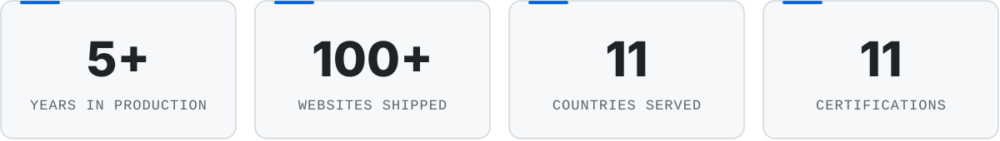

 

  
  
  
  
  

 

 

## `$ cat about.md`

I'm a **DevOps Engineer** who builds and runs containerized infrastructure: Docker stacks, reverse proxies, Linux servers and CI/CD pipelines that deploy without drama.

Before DevOps, I spent **5 years shipping 100+ WordPress & WooCommerce sites** for clients in the 🇺🇸 USA, 🇦🇪 UAE, 🇬🇧 UK and 🇵🇰 Pakistan. So I know what "production" means: real users, real downtime, real clients on the phone.

- 🚀 **Now:** DevOps Engineer (Internship) @ **BuiltinSoft**, *Oct 2025 – present*
- 🌐 **Before:** WordPress Designer & Developer @ Xpert Tech · Social Buzz · Elite Commerce Tech, *2020 – 2025*
- 🎓 **Education:** BS Computer Science, KFUEIT
- 🌱 **Learning:** Kubernetes · Terraform · Ansible · Prometheus · Grafana · AWS

## `$ ls ~/stack`

  

  
  
  
  
  
  
  

🌱 <b>next up</b> 
  

## `$ ls ~/projects`

<table>
  <tr>
    <td width="50%" valign="top">
      <h3>⚡ <a href="https://github.com/myselfusman/github-actions-ec2-deploy">github-actions-ec2-deploy</a></h3>
      
Production CI/CD pipeline that ships a Next.js app to <b>AWS EC2</b> using GitHub Actions, rsync and <b>atomic versioned releases</b>, with zero-downtime deploys behind NGINX + PM2.

      
🔥 <i>Debugged real production incidents: OOM crashes, SSH auth failures and 502 Bad Gateway.</i>

      <code>GitHub Actions</code> <code>EC2</code> <code>NGINX</code> <code>PM2</code>
    </td>
    <td width="50%" valign="top">
      <h3>💻 <a href="https://github.com/myselfusman/DevOps-Terminal-Portfolio">DevOps-Terminal-Portfolio</a></h3>
      
A fully interactive portfolio that behaves like a real shell. Type commands to explore my work.

      
🔗 <a href="https://terminal.myselfusman.com/"><b>terminal.myselfusman.com</b></a>

      <code>TypeScript</code> <code>Next.js</code> <code>Vercel</code>
    </td>
  </tr>
  <tr>
    <td width="50%" valign="top">
      <h3>🎨 <a href="https://github.com/myselfusman/hybrid-portfolio">hybrid-portfolio</a></h3>
      
My DevOps portfolio: terminal aesthetic, glassmorphism and smooth animations.

      
🔗 <a href="https://devops.myselfusman.com/"><b>devops.myselfusman.com</b></a>

      <code>TypeScript</code> <code>Next.js</code>
    </td>
    <td width="50%" valign="top">
      <h3>🧪 Hands-on DevOps Labs</h3>
      
🐳 Multi-service Docker Compose infra with custom networks, volumes &amp; internal DNS 
      🔀 NGINX + Traefik reverse proxy &amp; dynamic routing 
      📦 Portainer stack deployment &amp; monitoring 
      🌉 Docker networking &amp; Linux bridge experiments 
      🖥️ Self-hosted VPS environment over SSH

    </td>
  </tr>
</table>

## `$ cat certifications.txt`

  
  
  
  
  

## `$ git log --graph`

  

<picture>
  <source media="(prefers-color-scheme: dark)" srcset="https://raw.githubusercontent.com/myselfusman/myselfusman/output/github-snake-dark.svg" />
  <source media="(prefers-color-scheme: light)" srcset="https://raw.githubusercontent.com/myselfusman/myselfusman/output/github-snake.svg" />
  
</picture>

## `$ ./contact.sh`

  Open to <b>DevOps roles</b>, <b>internships</b> and <b>freelance work</b>: Docker setups, CI/CD pipelines, VPS &amp; WordPress hosting.  
  📧 <a href="mailto:contact@myselfusman.com">contact@myselfusman.com</a> &nbsp;·&nbsp;
  📱 <a href="https://wa.me/923046101141">+92 304 6101141</a> &nbsp;·&nbsp;
  💼 <a href="https://www.linkedin.com/in/myself-usman/">LinkedIn</a> &nbsp;·&nbsp;
  🌐 <a href="https://devops.myselfusman.com/">Portfolio</a>

 

