<a href="https://devops.myselfusman.com/">
  <picture>
    <source media="(prefers-color-scheme: dark)" srcset="./assets/header-dark.svg" />
    
  </picture>
</a>

 

  
  
  
  
  

<picture>
  <source media="(prefers-color-scheme: dark)" srcset="./assets/stats-dark.svg" />
  
</picture>

## `$ cat about.md`

I'm a **DevOps Engineer** working with Linux, AWS, Docker, CI/CD, Jenkins, GitHub Actions and Nginx.

Since 2021 I've built and maintained the infrastructure behind **100+ WordPress and WooCommerce websites**: hosting, DNS, MySQL, deployments and keeping live sites running. Clients came from the USA, Canada, UK, France, UAE, Saudi Arabia, Australia, Morocco, Ghana, Cameroon, Azerbaijan and Pakistan. I moved into DevOps to automate the work I'd been doing by hand.

- **DevOps Engineer (Internship)** at BuiltinSoft, *Oct 2025 – Dec 2026*
- **WordPress Developer**, freelance, *Mar 2024 – present*
- **WordPress Developer / Designer** at Elite Commerce, Social Buzz and Xpert Tech, *2021 – 2024*
- **Education:** BS Computer Science, KFUEIT (2018 – 2023)
- **Languages:** English (C1, EF SET), Urdu, Punjabi
- **Learning:** Kubernetes and Infrastructure as Code (Terraform, Ansible)

Looking for DevOps roles, **onsite in Pakistan or remote** with international teams.

## `$ ls ~/stack`

  <a href="#-ls-stack">
  <picture>
      <source media="(prefers-color-scheme: dark)" srcset="https://skillicons.dev/icons?i=linux,ubuntu,docker,nginx,jenkins,githubactions,aws,cloudflare,git,github,bash,python,nextjs,wordpress&perline=14&theme=dark" />
      
    </picture>
  </a>

  
  
  
  
  
  

<b>Learning next</b> 
  <a href="#-ls-stack">
  <picture>
      <source media="(prefers-color-scheme: dark)" srcset="https://skillicons.dev/icons?i=kubernetes,terraform,ansible,prometheus,grafana&theme=dark" />
      
    </picture>
  </a>

## `$ ls ~/projects`

<table>
  <tr>
    <td width="50%" valign="top">
      <h3><a href="https://github.com/myselfusman/github-actions-ec2-deploy">github-actions-ec2-deploy</a></h3>
      
GitHub Actions pipeline that deploys a Next.js app to <b>AWS EC2</b> with versioned releases, atomic switching, PM2 reloads and health checks, behind Nginx.

      
While running it I fixed SSH authentication errors, 502s and OOM crashes.

      <code>GitHub Actions</code> <code>EC2</code> <code>Nginx</code> <code>PM2</code>
    </td>
    <td width="50%" valign="top">
      <h3><a href="https://github.com/myselfusman/DevOps-Terminal-Portfolio">DevOps-Terminal-Portfolio</a></h3>
      
Portfolio website that works like a terminal: you type commands to see my projects and skills.

      
Live: <a href="https://terminal.myselfusman.com/">terminal.myselfusman.com</a>

      <code>TypeScript</code> <code>Next.js</code> <code>Vercel</code>
    </td>
  </tr>
  <tr>
    <td width="50%" valign="top">
      <h3><a href="https://github.com/myselfusman/hybrid-portfolio">hybrid-portfolio</a></h3>
      
My main DevOps portfolio website.

      
Live: <a href="https://devops.myselfusman.com/">devops.myselfusman.com</a>

      <code>TypeScript</code> <code>Next.js</code>
    </td>
    <td width="50%" valign="top">
      <h3>DevOps labs</h3>
      <ul>
        <li>Containerized apps with Docker Compose, custom bridge networks and service-to-service DNS</li>
        <li>Nginx reverse proxy and routing</li>
        <li>Ubuntu server administration over SSH</li>
        <li>Self-hosted VPS for containerized apps</li>
      </ul>
    </td>
  </tr>
</table>

## `$ cat certifications.txt`

  
  
  
  
  
  
  

## `$ git log --graph`

  <picture>
    <source media="(prefers-color-scheme: dark)" srcset="https://streak-stats.demolab.com?user=myselfusman&theme=github-dark-blue&hide_border=true&background=0D1117&ring=22D3EE&fire=22D3EE&currStreakLabel=22D3EE" />
    
  </picture>

<picture>
  <source media="(prefers-color-scheme: dark)" srcset="https://raw.githubusercontent.com/myselfusman/myselfusman/output/github-snake-dark.svg" />
  <source media="(prefers-color-scheme: light)" srcset="https://raw.githubusercontent.com/myselfusman/myselfusman/output/github-snake.svg" />
  
</picture>

## `$ ./contact.sh`

  Open to DevOps roles, onsite in Pakistan or remote. Also available for freelance Docker, CI/CD, VPS and WordPress hosting work.  
  <a href="mailto:contact@myselfusman.com">contact@myselfusman.com</a> &nbsp;·&nbsp;
  <a href="https://wa.me/923046101141">+92 304 6101141</a> &nbsp;·&nbsp;
  <a href="https://www.linkedin.com/in/myself-usman/">LinkedIn</a> &nbsp;·&nbsp;
  <a href="https://devops.myselfusman.com/">Portfolio</a>

<picture>
  <source media="(prefers-color-scheme: dark)" srcset="./assets/footer-dark.svg" />
  
</picture>
